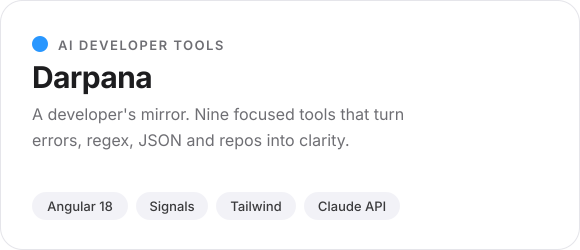
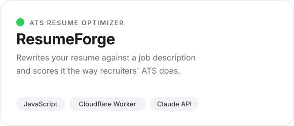
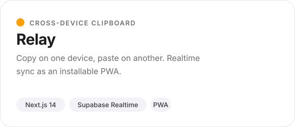
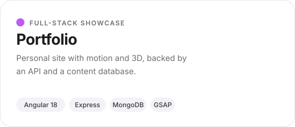

<picture>
  <source media="(prefers-color-scheme: dark)" srcset="assets/header-dark.svg">
  
</picture>

  

 

### Hi, I'm Darshan.

I build frontends that stay fast and calm as they grow. Four years of Angular, TypeScript and RxJS, from network management platforms to design systems shared across Angular and React teams.

- **Now** &nbsp; Software Developer at Luxoft, a DXC company, building design-system tooling across Angular and React.
- **Before** &nbsp; Terralogic, on a micro-frontend network management platform built with Angular, NgRx and RxJS.
- **On the side** &nbsp; Small tools that remove friction, usually with an AI model inside.
- **Based in** &nbsp; Bengaluru, India.

 

### Selected work

<table>
<tr>
<td width="50%">
<a href="https://github.com/nayakdarshan/darpana">
<picture>
  <source media="(prefers-color-scheme: dark)" srcset="assets/card-darpana-dark.svg">
  
</picture>
</a>
</td>
<td width="50%">
<a href="https://github.com/nayakdarshan/ats-resume-optimizer">
<picture>
  <source media="(prefers-color-scheme: dark)" srcset="assets/card-resume-dark.svg">
  
</picture>
</a>
</td>
</tr>
<tr>
<td width="50%">
<a href="https://github.com/nayakdarshan/relay">
<picture>
  <source media="(prefers-color-scheme: dark)" srcset="assets/card-relay-dark.svg">
  
</picture>
</a>
</td>
<td width="50%">
<a href="https://github.com/nayakdarshan/Portfolio-FullStack">
<picture>
  <source media="(prefers-color-scheme: dark)" srcset="assets/card-portfolio-dark.svg">
  
</picture>
</a>
</td>
</tr>
</table>

 

### Toolkit

  

Also: RxJS, NgRx, Signals, MUI, PrimeNG, Storybook, Jasmine, Jest, GitHub Actions.

 

### Activity

<picture>
  <source media="(prefers-color-scheme: dark)" srcset="https://github-readme-stats.vercel.app/api?username=nayakdarshan&show_icons=true&hide_border=true&bg_color=00000000&title_color=f5f5f7&text_color=a1a1a6&icon_color=2997ff&hide_rank=true&count_private=true">
  
</picture>

 

Designed with care in Bengaluru.

